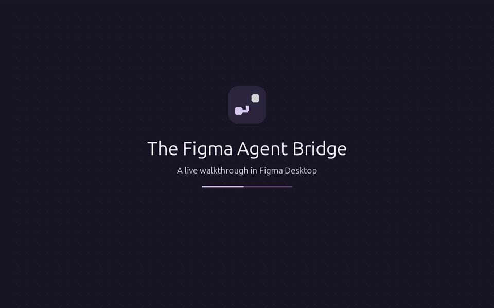

<p align="center"></p>

<h1 align="center">Figma Agent Bridge</h1>

<p align="center">
  Let your AI assistant inspect Figma designs and create editable layers in the file you have open.
</p>

<p align="center">
  <a href="../../actions/workflows/check.yml"></a>
  <a href="LICENSE"></a>
</p>

<p align="center">
  <a href="docs/figma-agent-bridge-demo.mp4"></a>
  <br>
  <a href="docs/figma-agent-bridge-demo.mp4">▶ Watch the live Figma Desktop walkthrough with sound</a>
</p>

Figma Agent Bridge connects a local [MCP](https://modelcontextprotocol.io) client
to Figma Desktop through a development plugin. Use it to turn a design into
code, export the assets you need, or build native Figma layouts with your assistant.

## Features

- **Inspect a design section by section.** Start with an outline, then read the layout, typography, component variants, and variables for a selected frame.
- **Create and edit native layers.** Build frames, text, shapes, and instances. Update properties or apply related changes within one frame. The layers stay editable in Figma.
- **Export design assets.** Save SVGs, PNGs, and original image fills as local files. Use a PNG preview to review an edit before moving on.
- **Read long text and design tokens on demand.** Retrieve styled text in chunks, or resolve only the variables a component actually uses.
- **Pair once on your machine.** Approve the connection in a browser. The companion starts on the first tool call, and the plugin remembers its pairing.
- **Keep the canvas clear.** Collapse the plugin to a small connection bar while the bridge runs. Expand it to get back to the full controls.
- **Troubleshoot a connection.** Check client registration and companion status with `doctor`. Its `--share` mode omits local paths and Figma file details.

<details>
<summary>Walkthrough transcript</summary>

1. **Find the import command.** Open **Plugins → Development** from the Figma canvas. Follow [Quick Start](#quick-start) to import the manifest and pair through the browser.
2. **Collapse the panel.** With the plugin paired, collapse it to the connection bar. The bridge creates a new frame on the active page.
3. **Add a triangle.** Draw a native polygon in Figma. The bridge changes its fill and layer name.
4. **Add text and a button.** The bridge creates native text layers and an Auto Layout button. Each step is visible in Figma's Layers panel.
5. **Edit and export.** The bridge updates the label from **Save to list** to **Save this trail**, then exports a PNG of the finished frame.

The video uses live Figma Desktop footage, animated captions, an original
soundtrack, and action cues. The GIF is a silent preview.

</details>

## Quick Start

Clone or download this repository and run the installer from the source folder.
The bootstrap downloads and verifies its own Node runtime. You don't need an
existing Node installation, an npm install, or a Figma API key.

| System running your AI client | Command |
| --- | --- |
| Windows (PowerShell) | `powershell -NoProfile -ExecutionPolicy Bypass -File .\bootstrap.ps1 -Client codex` |
| macOS, Linux, or WSL | `sh ./bootstrap.sh --client codex` |

Choose `codex`, `claude-code`, `claude-desktop` (Windows/macOS), or `both`
(Codex and Claude Code). The bootstrap installs a verified Node runtime and
registers the bridge with the selected client.

1. Open a design in **Figma Desktop** on Windows or macOS. Choose **Plugins → Development → Import plugin from manifest** and select the manifest path printed by setup.
2. Run **Figma Agent Bridge (Local)**, choose **Pair this computer**, and approve the connection in your browser.
3. Restart or reload your AI client, leave the plugin open, and ask it to run `figma_status`. Check that it reports the file and page you intend to use.

| Where Figma and your assistant run | Setup |
| --- | --- |
| Windows or macOS, same computer | Run the bootstrap and import the manifest from the installed folder. |
| Figma on Windows, assistant in local WSL | Use a Windows-accessible manifest and check [WSL localhost forwarding](INSTALL.md#ssh-to-wsl-on-another-computer). |
| Figma on Windows, assistant on remote WSL over SSH | Use the [matching Windows plugin bundle and SSH helper](INSTALL.md#ssh-to-wsl-on-another-computer). |
| Figma in a Linux browser | The Linux companion is supported. Figma browser pairing on Linux is unverified. |

See the [diagnostic commands](INSTALL.md#connection-checks) if the assistant cannot see the tools or the plugin stays disconnected.

<details>
<summary>Have your AI assistant install it</summary>

Give a local Codex or Claude Code session access to the repository and ask:

> Install Figma Agent Bridge for my current local AI client. Follow INSTALL.md,
> preserve my existing client setup, and walk me through pairing in Figma.

</details>

## Use it with your assistant

In Codex, invoke `$figma-local`. In Claude Code, use `/figma-local`. The
plugin must stay running in the target Figma file while your assistant works.
Use **Collapse** to tuck it out of the way. Closing the plugin ends the session. In
Claude Desktop, ask for the `figma-local` tools directly. Other local MCP
clients can connect over stdio using the [manual setup instructions](USAGE.md#legacy-manual-client-configuration).

| Try asking | What the bridge returns |
| --- | --- |
| “Inspect the selected checkout frame and describe its spacing and text styles.” | Scoped layout and typography data. |
| “Export the selected logo as an SVG.” | A local asset path with file type and checksum. |
| “Create a card with Auto Layout on this page and show me a PNG.” | Native layers in Figma and a rendered preview for review. |

To switch files, close the plugin in the first file and run it in the next one.
Ask the assistant to confirm the new file and page before making edits.

<details>
<summary>Available tools</summary>

| Tool | Purpose |
| --- | --- |
| `figma_status` | Confirm the connection and active file and page. |
| `figma_outline`, `figma_find` | Browse sections or find specific nodes and components. |
| `figma_inspect`, `figma_text` | Read layout, styles, components, and complete text. |
| `figma_tokens`, `figma_library` | Resolve variables and discover available fonts and styles. |
| `figma_schema`, `figma_edit` | Create or modify editable native layers. |
| `figma_asset`, `figma_export` | Save an asset locally or return a PNG preview. |

See the [usage guide](USAGE.md) for manual MCP setup, advanced options, and examples.

</details>

## How it works

```text
AI assistant  →  stdio MCP server  →  local companion  ↔  Figma plugin
```

The companion handles pairing and dispatch. The plugin reads and edits the
active page through Figma's Plugin API. Only one Figma file connects at a time.
After a timed-out edit, inspect the canvas before retrying to avoid applying the
same change twice. See the [usage guide](USAGE.md#reliability-and-scope) for
request handling and scope.

## Security and privacy

The companion listens on loopback and requires a local pairing approval. The
bridge uses Figma’s public Plugin API and sends no data through a hosted relay.
Your AI client may send design context to its model provider. Keep pairing
state, exported assets, and diagnostics containing file names private.

See [SECURITY.md](SECURITY.md) for the trust model and how to report a vulnerability.

## Development

Use Node.js 20 or newer. The bridge has no npm runtime dependencies.

```sh
npm test                # Run the regression suite
npm run verify:package  # Build and verify a clean source package
```

GitHub Actions runs the packaged checks on Windows, macOS, and Linux. For a
live check, pair in Figma Desktop, run the [editable scene demo](USAGE.md#daily-use),
and inspect its PNG. See the [source distribution guide](USAGE.md#source-distribution)
for the files included in the package.

## License

Figma Agent Bridge is available under the [MIT License](LICENSE).
